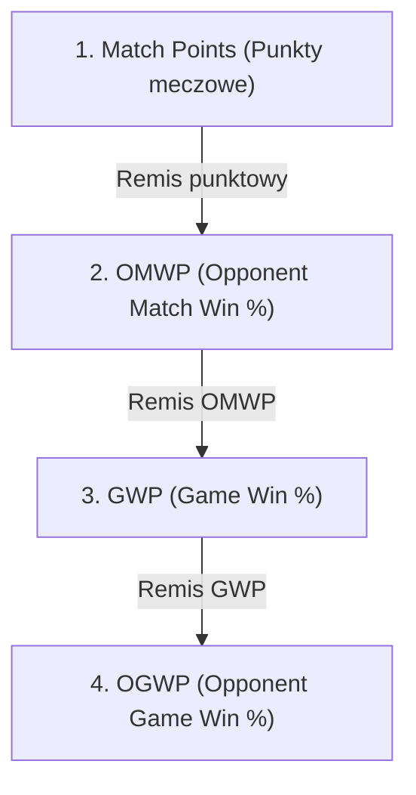
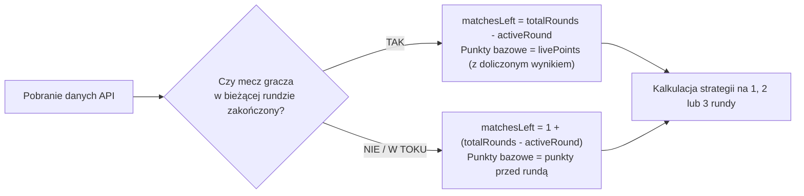
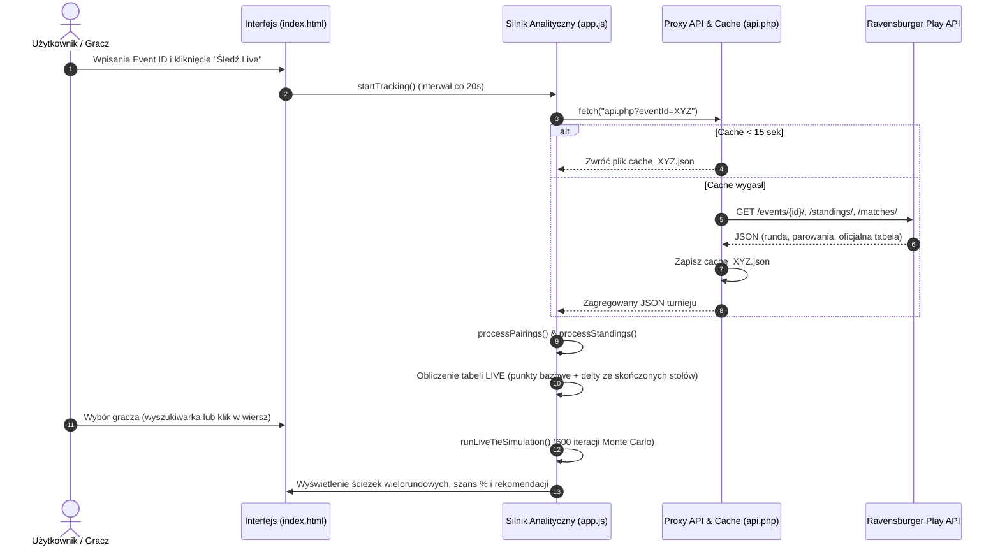

# 🏆 Lorcana Live Predictor & Standings Hub

Zaawansowany system analizy turniejowej na żywo oraz silnik decyzyjny dla graczy turniejowych **Disney Lorcana TCG** (zintegrowany z platformą Ravensburger Play / Melee). 

Aplikacja nie tylko prezentuje oficjalną i dynamiczną tabelę wyników live, ale przede wszystkim analizuje układ tabeli, **oblicza tiebreakery przeciwników (OMWP, GWP)** oraz wykorzystuje **symulację Monte Carlo**, aby wyznaczyć optymalną strategię gracza **nawet na 2 do 3 rund do przodu**.

---

## 📑 Spis Treści
1. [Mechanika Tiebreakerów w Disney Lorcana](#-mechanika-tiebreakerów-w-disney-lorcana)
   - [Punkty Meczowe (Match Points)](#punkty-meczowe-match-points)
   - [OMWP (Opponent Match Win Percentage)](#omwp-opponent-match-win-percentage)
   - [GWP (Game Win Percentage)](#gwp-game-win-percentage)
   - [OGWP (Opponent Game Win Percentage)](#ogwp-opponent-game-win-percentage)
   - [Tryby Cutu: Hard Cut vs Soft Cut](#tryby-cutu-hard-cut-vs-soft-cut)
2. [Świadomość Liczby Rund i Stanu Meczu (Round Awareness)](#-świadomość-liczby-rund-i-stanu-meczu-round-awareness)
   - [Wykrywanie całkowitej liczby rund](#wykrywanie-całkowitej-liczby-rund)
   - [Analiza statusu bieżącego stołu](#analiza-statusu-bieżącego-stołu)
   - [Licznik pozostałych meczów (`matchesLeft`)](#licznik-pozostałych-meczów-matchesleft)
3. [Architektura Silnika Symulacji Monte Carlo](#-architektura-silnika-symulacji-monte-carlo)
   - [Pobieranie stanu turnieju i zamrażanie zakończonych stołów](#1-pobieranie-stanu-turnieju-i-zamrażanie-zakończonych-stołów)
   - [Symulacja przyszłych rund Swiss](#2-symulacja-przyszłych-rund-swiss)
   - [Dynamiczna ewolucja OMWP w czasie](#3-dynamiczna-ewolucja-omwp-w-czasie)
   - [Psychologia graczy: Intentional Draw (ID) na wysokich stołach](#4-psychologia-graczy-intentional-draw-id-na-wysokich-stołach)
4. [Obliczanie Najlepszej Strategii na 2 i 3 Rundy do Przodu](#-obliczanie-najlepszej-strategii-na-2-i-3-rundy-do-przodu)
   - [Projekcja progu wejścia (Projected Bubble Score)](#projekcja-progu-wejścia-projected-bubble-score)
   - [Analiza ścieżek wielorundowych (Multi-Round Scenarios)](#analiza-ścieżek-wielorundowych-multi-round-scenarios)
   - [Drzewo decyzyjne i rekomendacje taktyczne](#drzewo-decyzyjne-i-rekomendacje-taktyczne)
5. [Teoria Gier: Wzajemna Analiza Stołu i Asymetria ID](#-teoria-gier-wzajemna-analiza-stołu-i-asymetria-id)
   - [Obopólny Złoty Remis (Mutual Safe ID)](#obopólny-złoty-remis-mutual-safe-id)
   - [Asymetria Stołu (Table Asymmetry)](#asymetria-stołu-table-asymmetry)
   - [Pułapka Remisu (Tie Trap)](#pułapka-remisu-tie-trap)
6. [Architektura Techniczna i Przepływ Danych](#-architektura-techniczna-i-przepływ-danych)
7. [Instalacja i Uruchomienie](#-instalacja-i-uruchomienie)

---

## 🧮 Mechanika Tiebreakerów w Disney Lorcana

W turniejach Disney Lorcana (oraz w systemie Ravensburger Play / Melee) o kolejności w tabeli decydują cztery hierarchiczne kryteria:



### Punkty Meczowe (Match Points)
Każdy mecz w fazie Swiss przyznaje punkty według reguły:
- **Zwycięstwo (Win)**: `3 punkty`
- **Remis (Tie / Intentional Draw / Unintentional Draw)**: `1 punkt`
- **Porażka (Loss)**: `0 punktów`

### OMWP (Opponent Match Win Percentage)
Główny wskaźnik pomocniczy rozstrzygający remisy punktowe. Określa siłę przeciwników, z którymi mierzył się dany gracz.

#### Zasada "Floor 33.33%" (Dolny Limit)
Zgodnie z oficjalnymi zasadami turniejowymi, procent wygranych żadnego przeciwnika nie może spaść poniżej **33.33% (0.3333)**. Oznacza to, że rywal, który przegrał wszystkie mecze (0-4) lub wycofał się z turnieju (drop), jest wliczany jako $0.3333$, a nie $0.0000$. Chroni to gracza przed drastyczną karą za wylosowanie słabszego przeciwnika w pierwszych rundach.

Wzór na wskaźnik meczowy przeciwnika $i$:
$$MWP_i = \max\left(0.3333, \frac{\text{Punkty Meczu Rywala}_i}{3 \times \text{Liczba Rozegranych Rund}}\right)$$

Wzór na OMWP gracza:
$$OMWP = \frac{1}{K} \sum_{i=1}^{K} MWP_i$$
*(gdzie $K$ to liczba unikalnych przeciwników, z którymi gracz grał).*

### GWP (Game Win Percentage)
Drugi tiebreaker, stosowany przy równych punktach i identycznym OMWP. Określa stosunek wygranych pojedynczych partii (gier) w meczach (np. wygrana meczu wynikiem 2-0 daje 100% GWP, a 2-1 daje 66.7% GWP). Tutaj również stosuje się minimalny próg $33.33\%$.

### OGWP (Opponent Game Win Percentage)
Trzeci tiebreaker, stosowany gdy gracze mają identyczne punkty meczowe, identyczny OMWP oraz identyczny GWP. Określa średnią ze wskaźników Game Win Percentage (GWP) wszystkich przeciwników danego gracza:

$$OGWP = \frac{1}{K} \sum_{i=1}^{K} \max\left(0.3333, GWP_{opp, i}\right)$$

Wskaźnik ten mierzy, jak trudne i zacięte gry toczyli Twoi rywale. Każdy rywal jest uwzględniany z minimalnym progiem ochronnym $33.33\%$. Choć decyduje o awansie rzadziej niż punkty i OMWP, na turniejach z setkami graczy (np. oficjalne turnieje Lorcana Challenge) różnice ułamków procenta w OGW% potrafią przesądzić o wejściu do Top 8 lub Top 64!

### Tryby Cutu: Hard Cut vs Soft Cut
System pozwala wybrać regułę awansu do fazy pucharowej:
- **Twardy Cut (`hard` - np. ME 2)**: Do fazy pucharowej wchodzi ściśle określona liczba graczy (np. dokładnie Top 4 lub Top 8). Przy równych punktach na granicy odcięcia o awansie decydują ułamki procenta **OMWP / GWP / OGWP**.
- **Miękki Cut (`soft` - np. ME 1)**: Do Cutu kwalifikują się wszyscy gracze, którzy uzyskali taką samą liczbę punktów jak gracz na ostatnim premiowanym miejscu (Top X + ties).

---

## ⏱️ Świadomość Liczby Rund i Stanu Meczu (Round Awareness)

Jednym z najważniejszych elementów algorytmu jest **pełna świadomość kontekstu turnieju**. Silnik nie generuje statycznych porad — dynamicznie dostosowuje obliczenia do tego, w jakim momencie turnieju znajduje się gracz.



### Wykrywanie całkowitej liczby rund
Liczba rund fazy Swiss (`totalRounds`) jest ustalana na dwa sposoby:
1. Bezpośrednio z konfiguracji faz turnieju w API Ravensburgera (`tournament_phases[].rounds`).
2. W razie braku tych danych w API — automatycznie z oficjalnej tabeli Swiss wg liczby zarejestrowanych uczestników:
   - **≤ 8 graczy**: 3 rundy
   - **9–16 graczy**: 4 rundy
   - **17–32 graczy**: 5 rund
   - **33–64 graczy**: 6 rund
   - **65–128 graczy**: 7 rund
   - **129–226 graczy**: 8 rund
   - **227+ graczy**: 9 rund

### Analiza statusu bieżącego stołu
W funkcji [`runLiveTieSimulation`](file:///c:/xampp/htdocs/lorcana-analitics/app.js#L1198) algorytm bada status meczu wybranego gracza:
- Sprawdza flagi `status === 'COMPLETE'`, obecność zwycięzcy (`winnerId`) oraz wynik w gemach (`games_won_by_winner`).
- **Jeśli mecz się zakończył**: ustala stałą deltę punktową (`targetFixedRoundDelta` = +3 za win, +1 za remis, +0 za loss) i odejmuje bieżącą rundę z puli pozostałych spotkań.
- **Jeśli mecz wciąż trwa**: runda bieżąca jest traktowana jako aktywny, nierozstrzygnięty mecz.

### Licznik pozostałych meczów (`matchesLeft`)
Zmienna `matchesLeft` definiuje horyzont decyzyjny:
$$\text{matchesLeft} = \begin{cases} \text{totalRounds} - \text{currentRound} & \text{jeśli mecz w bieżącej rundzie jest zakończony} \\ 1 + (\text{totalRounds} - \text{currentRound}) & \text{jeśli mecz w bieżącej rundzie trwa} \end{cases}$$

Dzięki temu algorytm dokładnie wie:
- Kiedy jesteśmy w **ostatniej rundzie** (`matchesLeft === 1`) — bezpośrednia walka o "Win & In" lub pojedynczy Intentional Draw.
- Kiedy do końca zostały **2 rundy** (`matchesLeft === 2`) — możliwość zbadania podwójnego remisu (`2x ID`) lub kombinacji Win + Draw.
- Kiedy pozostały **3 lub więcej rund** (`matchesLeft >= 3`) — kalkulacja wymaganych zwycięstw i prognozowanie ostatecznego progu punktowego (Bubble Score).

---

## 🎲 Architektura Silnika Symulacji Monte Carlo

Aby obliczyć szanse awansu, algorytm przeprowadza **600 pełnych iteracji turnieju Monte Carlo** (`SIM_COUNT = 600`) przy każdym odświeżeniu danych.

### 1. Pobieranie stanu turnieju i zamrażanie zakończonych stołów
W każdej iteracji tworzona jest wirtualna tablica graczy (`simBoard`):
- Gracze, których mecze w bieżącej rundzie już się zakończyły, mają na sztywno przypisane punkty z API (`fixedMatchDeltas`).
- Stoły, które wciąż grają, podlegają losowaniu z realistycznym rozkładem prawdopodobieństw opartym na specyfice gry Lorcana:
  - **8%** szansa na remis (Unintentional Draw z powodu limitu czasu)
  - **46%** szansa na wygraną Gracza 1
  - **46%** szansa na wygraną Gracza 2

### 2. Symulacja przyszłych rund Swiss
Dla każdej przyszłej rundy $r$ od $\text{currentRound} + 1$ do $\text{totalRounds}$:
1. **Sortowanie szwajcarskie**: Tablica jest sortowana według punktów malejąco (z drobną losową permutacją rozstrzygającą remisy).
2. **Parowanie w koszykach punktowych**: Gracz z miejsca 1 gra z miejscem 2, miejsce 3 z miejscem 4 itd.
3. **Rejestracja par**: Każdy nowy przeciwnik jest dodawany do listy rywali danego gracza (`p.opponents.push(oppId)`).

### 3. Dynamiczna ewolucja OMWP w czasie
Najczęstszym błędem prostych kalkulatorów jest założenie, że OMWP jest stałe. W rzeczywistości OMWP zmienia się z każdą rundą, ponieważ:
- Wszyscy dotychczasowi rywale grają kolejne mecze (zmieniają swoje punkty).
- W każdej kolejnej rundzie gracz otrzymuje nowego rywala, który wnosi swoje MWP do średniej.

Nasz algorytm modeluje to za pomocą ważenia historycznego:
$$MWP_{opp, r} = \max\left(0.3333, \frac{\text{punkty rywala w symulacji}}{3 \times \text{totalRounds}}\right)$$
$$\text{finalOmwp} = \frac{(\text{baseOmwp} \times \text{baseWeight}) + \sum MWP_{opp}}{\text{baseWeight} + \text{nowi rywale}}$$
*(gdzie $\text{baseWeight} = \max(1, \text{currentRound} - 1)$).*

### 4. Psychologia graczy: Intentional Draw (ID) na wysokich stołach
W turniejach karcianych gracze na szczycie tabeli w ostatniej rundzie nie grają meczu, jeśli remis gwarantuje awans obu stronom.

Algorytm uwzględnia to zachowanie:
```javascript
const isFinalRound = (r === totalRounds);
const bothCanID = isFinalRound && (p1.points >= projectedFinalBubble && p2.points >= projectedFinalBubble);

if (bothCanID && Math.random() < 0.75) {
    p1.points += 1;
    p2.points += 1;
}
```
Jeżeli obaj sparowani gracze w rundzie finałowej przekraczają szacowany próg wejścia, symulacja z prawdopodobieństwem **75%** przypisuje im obopólny remis (`ID`), co doskonale odzwierciedla realia stołów 1–4 na dużych turniejach.

---

## 🎯 Obliczanie Najlepszej Strategii na 2 i 3 Rundy do Przodu

Algorytm nie ogranicza się do oceny "co da remis w tym meczu". Analizuje całe drzewo scenariuszy wielorundowych.

### Projekcja progu wejścia (Projected Bubble Score)
Na bieżąco wyliczany jest szacowany ostateczny próg punktowy Cutu:
$$\text{Projected Final Bubble} = \left\lceil \frac{\text{Punkty gracza na pozycji Cut}}{\max(1, \text{activeRound})} \times \text{totalRounds} \right\rceil$$

Na przykład: jeśli po rundzie 4 na progu Top 4 potrzeba 9 punktów w turnieju 6-rundowym:
$$\text{Projected Bubble} = \left\lceil \frac{9}{4} \times 6 \right\rceil = \lceil 13.5 \rceil = 14 \text{ pkt}$$

### Analiza ścieżek wielorundowych (Multi-Round Scenarios)

Gdy do końca turnieju pozostały **2 lub więcej meczów** (`matchesLeft >= 2`), moduł [`renderMultiRoundScenarios`](file:///c:/xampp/htdocs/lorcana-analitics/app.js#L1133) testuje 5 fundamentalnych ścieżek punktowych:

| Scenariusz | Zmiana Pkt | Opis Taktyczny | Interpretacja Algorytmu |
| :--- | :---: | :--- | :--- |
| **2x TIE (2x ID)** | `+2 pkt` | Dwa celowe remisy z rzędu | Test, czy gracz ma tak bezpieczną pozycję, że może zremisować bieżący i następny mecz bez ryzyka. |
| **1x WIN + 1x TIE** | `+4 pkt` | Wygrana teraz + remis potem (lub odwrotnie) | Strategia "Win and In": wygranie jednego meczu otwiera drogę do bezpiecznego ID w rundzie finałowej. |
| **1x WIN + 1x LOSS** | `+3 pkt` | 1 zwycięstwo i 1 porażka | Margines błędu: czy po jednej porażce pojedyncze zwycięstwo wystarczy do awansu? |
| **1x TIE + 1x LOSS** | `+1 pkt` | 1 remis i 1 porażka | Scenariusz awaryjny (zwykle niewystarczający). |
| **2x WIN** | `+6 pkt` | Dwa zwycięstwa (komplet) | Maksymalny pułap punktowy — czy gracz ma jeszcze jakiekolwiek matematyczne szanse na Cut? |

#### Horyzont 3 rund do przodu (`matchesLeft >= 3`)
W przypadku 3 rund do końca system zestawia bieżące punkty gracza z prognozowanym progiem finałowym (`projectedBubble`):
- **Wymóg punktowy**: $\Delta P = \text{Projected Bubble} - \text{livePoints}$
- Jeśli $\Delta P \le 3$: Wystarczy **1x WIN + 2x TIE** (+5 pkt) lub **1x WIN + 1x TIE + 1x LOSS** (+4 pkt).
- Jeśli $\Delta P \in (3, 6]$: Konieczne minimum **2x WIN** (+6 pkt) lub **2x WIN + 1x TIE** (+7 pkt).
- Jeśli $\Delta P > 6$: Gracz musi zrobić **3x WIN** (+9 pkt) — algorytm natychmiast oznacza gracza etykietą *Wymaga kompletu zwycięstw*.

### Drzewo decyzyjne i rekomendacje taktyczne

```mermaid
graph TD
    Start["Analiza matchesLeft"] --> Check2{"matchesLeft >= 2?"}
    
    Check2 -->|TAK: 2 lub 3 rundy| DT_Eval{"Szansa przy 2x TIE"}
    DT_Eval -->|>= 85% i Rywal >= 85%| RecDoubleSafe["🤝 PODWÓJNY ZŁOTY REMIS<br/>Zaproponuj ID już teraz. Obaj wchodzicie!"]
    DT_Eval -->|>= 75% ale Rywal < 50%| RecDoubleAsym["⚠️ ASYMETRIA TABELI<br/>Remis premiuje Ciebie, ale rywal potrzebuje 3 pkt.<br/>Przygotuj się na odmowę i twardą grę!"]
    DT_Eval -->|< 50% oraz 1W+1T >= 75%| RecNeedWin["🎯 2x TIE TO ZA MAŁO<br/>Musisz powalczyć o 1 wygraną (1W+1T daje Cut).<br/>Nie bierz remisu teraz!"]
    DT_Eval -->|2x WIN < 40%| RecDead["🛑 POZA ZASIĘGIEM CUTU<br/>Nawet komplet zwycięstw nie daje awansu."]
    
    Check2 -->|NIE: Decydujący mecz (1 runda)| Final_Eval{"Szansa przy 1x TIE"}
    Final_Eval -->|>= 85% i Rywal >= 85%| RecFinalSafe["🤝 OBOPÓLNY ZŁOTY REMIS (ID)<br/>Bierz remis bez grania – 100% awans obu graczy."]
    Final_Eval -->|>= 70% ale Rywal < 50%| RecFinalAsym["⚠️ ASYMETRIA STOŁU<br/>Ty wchodzisz po remisie, rywal odpada.<br/>Rywal odrzuci ID – graj o zwycięstwo!"]
    Final_Eval -->|< 50%| RecMustWin["🛑 NIE BIERZ REMISU<br/>Remis wyrzuca Cię z Top Cutu.<br/>Jedyna droga to WIN (3 pkt)!"]
```

---

## 🤝 Teoria Gier: Wzajemna Analiza Stołu i Asymetria ID

Wielu graczy popełnia błąd pytając: *"Czy opłaca mi się wziąć remis?"*. Poprawne pytanie brzmi: **"Czy MNIE opłaca się wziąć remis ORAZ czy MOJEMU RYWALOWI opłaca się przyjąć propozycję?"**.

Algorytm bada sytuację obu graczy przy danym stole (`targetPlayer` vs `myOpponent`):

### Obopólny Złoty Remis (Mutual Safe ID)
- **Warunek**: `chanceDoubleTie >= 85%` ORAZ `oppChanceDoubleTie >= 85%` (lub `chanceTie >= 85%` i `oppChanceTie >= 85%` w ostatniej rundzie).
- **Rekomendacja**: 🟢 **Zielony baner bezpieczeństwa**. Obaj gracze mają identyczny interes matematyczny. Złożenie propozycji ID kończy się natychmiastową akceptacją, gwarantując obu stronom awans bez ryzyka losowej porażki.

### Asymetria Stołu (Table Asymmetry)
- **Warunek**: Gracz ma wysokie szanse po remisie (`chanceTie >= 70%`), ale rywal ma niskie szanse (`oppChanceTie < 50%`).
- **Przyczyna**: Rywal ma gorsze OMWP lub o 1 punkt mniej w tabeli. Remis da mu np. 9. miejsce (tuż pod kreską), podczas gdy wygrana daje pewny awans.
- **Rekomendacja**: 🟠 **Pomarańczowy baner ostrzegawczy**. Choć gracz chciałby remisu, **rywal prawie na pewno odrzuci propozycję**, ponieważ matematyka zmusza go do walki o 3 punkty. Gracz musi mentalnie i strategicznie przygotować się do pełnego meczu.

### Pułapka Remisu (Tie Trap)
- **Warunek**: `chanceTie < 50%`, a `chanceWin >= 80%`.
- **Zjawisko**: Gracz znajduje się w strefie *Bubble*. Dodanie 1 punktu za remis sprawi, że wyprzedzą go zwycięzcy niższych stołów (którzy zgarną po 3 punkty).
- **Rekomendacja**: 🔴 **Czerwony baner zakazu remisu**. Propozycja remisu w tej sytuacji jest błędem taktycznym eliminującym gracza z turnieju.

---

## 🏗️ Architektura Techniczna i Przepływ Danych

System działa w modelu hybrydowym (PHP backend jako proxy/cache + JavaScript w przeglądarce):



### Pliki w projekcie:
- [`api.php`](file:///c:/xampp/htdocs/lorcana-analitics/api.php): Bezpieczny backend komunikujący się z API Cloudflare Hydraproxy Ravensburgera. Pobiera parowania wszystkich rozegranych rund (`roundsMatches`), autoryzację tokenem oraz obsługuje 15-sekundowy cache zapytań cURL.
- [`app.js`](file:///c:/xampp/htdocs/lorcana-analitics/app.js): Główny silnik aplikacji. Odpowiada za:
  - Przeliczanie punktacji na żywo (`livePoints`).
  - Wyliczanie tiebreakerów OMWP i GWP.
  - Wykonywanie symulacji Monte Carlo [`runLiveTieSimulation`](file:///c:/xampp/htdocs/lorcana-analitics/app.js#L1198).
  - Wycenę scenariuszy wielorundowych [`renderMultiRoundScenarios`](file:///c:/xampp/htdocs/lorcana-analitics/app.js#L1133).
  - Generowanie porad taktycznych [`updateRecommendationBanner`](file:///c:/xampp/htdocs/lorcana-analitics/app.js#L1474).
  - Filtrowanie polskich zawodników (flagi, emoji gór/szczura, tagi teamów `GPL`, `M7`, `OSA`, `LV`, `Q2W` itd.).
  - Etykiety stanu awansu (`getCutStatusBadge`) i filtry statusów.
  - Inspektora tiebreakerów OMWP (`openOmwpInspector`) z analizą rywali i reguły floor 33.3%.
  - Symulator parowań szwajcarskich na kolejną rundę (`recalculateNextRoundPairingsPredictor`).
- [`index.html`](file:///c:/xampp/htdocs/lorcana-analitics/index.html): Nowoczesny, w pełni responsywny interfejs zoptymalizowany pod kątem smartfonów z modalem OMWP i kafelkami symulatora parowań.

---

## 🌟 Zaawansowane Moduły Turniejowe

### 1. 🏷️ Etykiety Stanu Awansu w Tabeli (Cut Status Badges)
W tabeli LIVE każdy gracz otrzymuje dynamiczną, kolorową odznakę określającą jego status:
- 🔒 **LOCKED**: Awans w 100% gwarantowany (nawet przy podwójnym remisie lub porażkach).
- 🎯 **WIN & IN**: Wygrana w meczu daje pewne wejście do Top Cutu ($\ge 75\%$).
- 🤝 **SAFE ID**: Gracz może bezpiecznie zaproponować i przyjąć remis.
- 🟡 **BUBBLE**: Gracz na granicy odcięcia – o awansie zdecydują ułamki procenta OMWP.
- ⚠️ **MUST WIN OUT**: Gracz musi wygrać wszystkie pozostałe mecze turnieju.
- 💀 **ELIMINATED**: Brak matematycznych szans na awans do Cutu.
- **Szybkie filtry**: Możliwość przefiltrowania tabeli do graczy walczących o Cut (`🎯 W grze o Cut`) lub wyłącznie strefy Bubble (`🟡 Tylko Bubble`).

### 2. 🕵️ Inspektor Tiebreakerów (OMWP / GW% / OGW% Inspector)
Kliknięcie w pole tiebreakerów w dowolnej tabeli lub przycisk **„🔍 Inspektor Tiebreakerów”** otwiera pełne okno analityczne:
- **Karty podsumowania 3 tiebreakerów**:
  - `1. OMW %` (Opponent Match Win %) – procent wygranych meczów Twoich rywali.
  - `2. GW %` (Game Win %) – Twój bezpośredni procent wygranych pojedynczych gier (np. 2-0 vs 2-1).
  - `3. OGW %` (Opponent Game Win %) – średni procent wygranych pojedynczych gier wszystkich Twoich rywali.
- **Tabela historii rywali**: Lista wszystkich przeciwników ze wszystkich rund turnieju wraz ze szczegółami:
  - **Rywal MW%**: wskaźnik meczowy przeciwnika (z uwzględnieniem zasady Floor 33.33%).
  - **Rywal GW%**: wskaźnik wygranych partii przeciwnika (źródło Twojego wskaźnika OGW%).
  - **Wpływ na OMW%**:
    - 🚀 **Podbija tiebreaker**: Rywal ma wysoki bilans i ciągnie Twoje OMWP w górę.
    - 🛡️ **Floor 33.33%**: Rywal ma słaby bilans, ale chroni Cię oficjalny dolny limit turniejowy.
    - 📉 **Obniża tiebreaker**: Rywal wygrał mniej meczów niż wynosi Twoja średnia.
  - **Status stołów na żywo**: Wyświetla, czy Twój były rywal wciąż gra mecz w bieżącej rundzie (np. `⚔️ Stół #4 (W grze)`).
- **Prognoza Min/Max OMWP**: Pokazuje, jak zmieni się Twoje OMWP, jeśli wszyscy Twoi byli rywale wygrają swoje trwające mecze vs jeśli wszyscy przegrają.

### 3. 🔮 Symulator Parowań: „Z kim zagram w kolejnej rundzie?” (Next Round Pairings Predictor)
Symuluje działanie algorytmu Swiss pairing dla następnej rundy ($R+1$):
- **Zasada No-Rematches**: Bezwzględnie wyklucza wszystkich graczy, z którymi już grałeś w turnieju.
- **Scenariusze bieżącego meczu**:
  - `🟢 Jeśli WYGRASZ (+3 pkt)`
  - `🟡 Jeśli ZREMISUJESZ (+1 pkt)`
  - `🔴 Jeśli PRZEGRASZ (+0 pkt)`
- **Kalkulacja prawdopodobieństwa**:
  - Przypisuje wagi na podstawie bliskości koszyków punktowych ($\Delta$), trwających meczów na sali oraz podobieństwa OMWP.
  - Wskazuje typ parowania: `Ten sam koszyk punktowy`, `Bliski Pair-up`, `Pair-down`.
  - Wyświetla posortowaną listę najbardziej prawdopodobnych rywali wraz z ich aktualnym dorobkiem i bilansem.

---

## 🚀 Instalacja i Uruchomienie

### Wymagania:
- Serwer WWW z obsługą PHP (np. **XAMPP**, WampServer, Docker z Apache/PHP lub wbudowany serwer PHP CLI).
- Rozszerzenie PHP `curl` oraz `json` (włączone domyślnie w XAMPP).

### Krok po kroku:
1. Skopiuj katalog projektu do folderu głównego serwera:
   ```bash
   # Przykład dla XAMPP:
   C:\xampp\htdocs\lorcana-analitics
   ```
2. Uruchom moduł **Apache** w panelu XAMPP (lub uruchom wbudowany serwer PHP):
   ```bash
   php -S localhost:8000
   ```
3. Otwórz przeglądarkę pod adresem:
   ```
   http://localhost/lorcana-analitics/
   ```
4. Wpisz **Event ID** turnieju z platformy Ravensburger Play (np. z linku do turnieju) i wybierz wielkość Cutu (np. `4` dla Top 4 lub `8` dla Top 8).
5. Kliknij **"Odśwież / Śledź Live"** — aplikacja natychmiast pobierze strukturę turnieju, przeliczy tiebreakery i zaprezentuje optymalne strategie!
